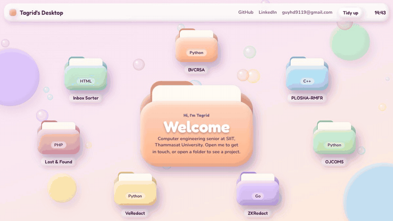
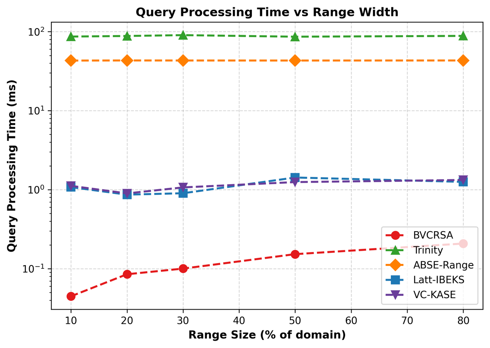
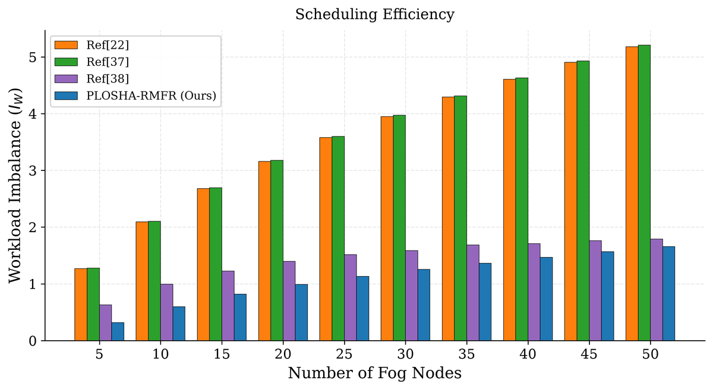
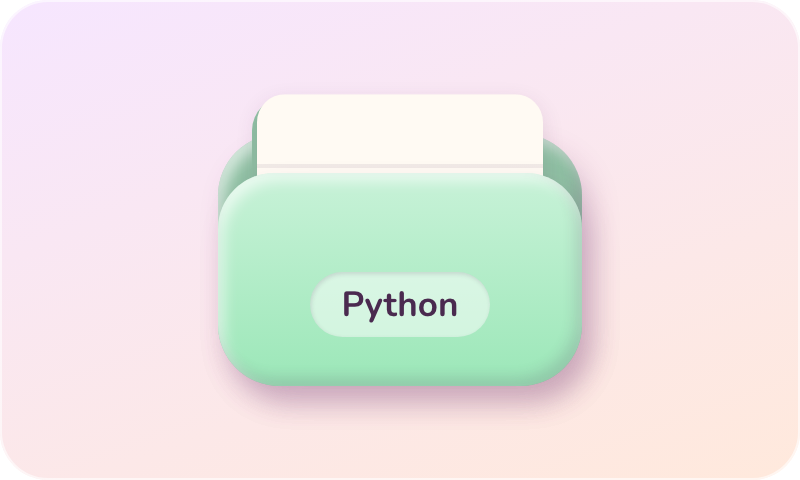
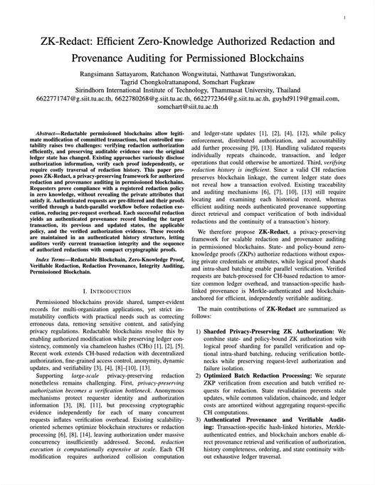
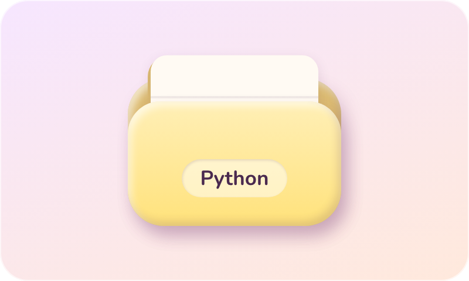
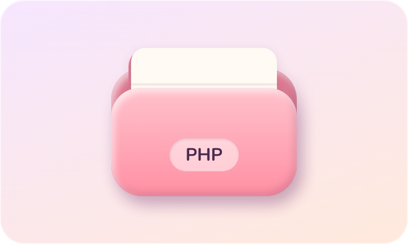
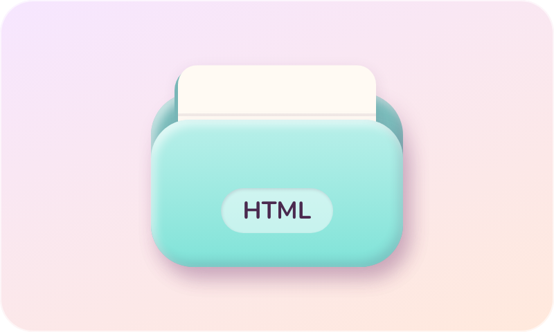

<h1 align="center">Hello, my name is Guy 👋</h1>

  <em>Welcome to my GitHub! Here are some of the projects I've been working on.</em>

  
   
  Open the folders on my site → <a href="https://jaoguya.vercel.app">jaoguya.vercel.app</a>

---

### 🔬 Feature Project Showcase

<table>
  <tr>
    <td width="50%" valign="top">
      
      <h4><a href="https://github.com/Jaoguya/BVCRSA">BVCRSA</a></h4>
      Blockchain-based verifiable conjunctive range search and aggregation over encrypted IIoT data. <i>IEEE Internet of Things Journal, 2nd revision. Earlier version (AC-SCRAT) accepted at IEEE CSCloud 2027.</i>
    </td>
    <td width="50%" valign="top">
      
      <h4><a href="https://github.com/Jaoguya/PLOSHA-RMFR">PLOSHA-RMFR</a></h4>
      Predictive load-sharing hierarchical aggregation with risk-aware multi-layer fault recovery. <i>IEEE Internet of Things Journal, under review.</i>
    </td>
  </tr>
  <tr>
    <td width="50%" valign="top">
      
      <h4><a href="https://github.com/Jaoguya/OJCOMS">OJCOMS</a></h4>
      Fog-assisted multi-authority verifiable dynamic searchable encryption with adaptive load balancing. <i>IEEE Open Journal of the Communications Society, in progress.</i>
    </td>
    <td width="50%" valign="top">
      
      <h4><a href="https://github.com/Jaoguya/ZKRedact">ZKRedact</a></h4>
      Efficient zero-knowledge authorized redaction and provenance auditing for permissioned blockchains. <i>Accepted at IEEE KST 2027.</i>
    </td>
  </tr>
  <tr>
    <td width="50%" valign="top">
      
      <h4><a href="https://github.com/Jaoguya/VeRedact">VeRedact</a></h4>
      Post-quantum secure verifiable redaction and privacy-preserving auditing for large-scale permissioned blockchains.
    </td>
    <td width="50%" valign="top">
      
      <h4><a href="https://github.com/Jaoguya/Lost-Found---website">Lost &amp; Found</a></h4>
      A web system for reporting, tracking and managing lost and found items.
    </td>
  </tr>
  <tr>
    <td width="50%" valign="top">
      
      <h4><a href="https://github.com/Jaoguya/jaoguyagmail">Inbox Sorter</a></h4>
      Sorts a Gmail inbox into Important, General and Ads, cleans it up with saved searches, and brings anything back with one click.
    </td>
    <td width="50%" valign="top"></td>
  </tr>
</table>

---

  
  
  

